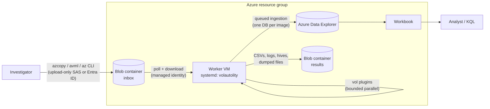
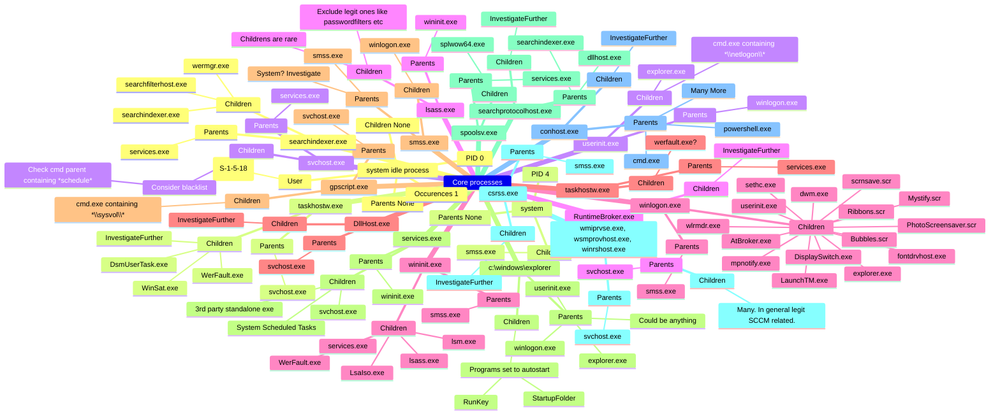
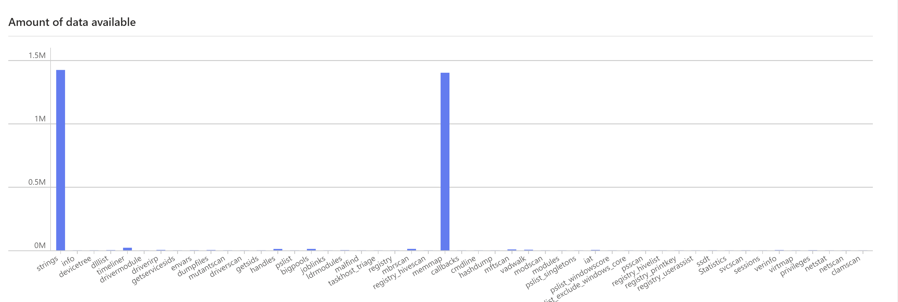
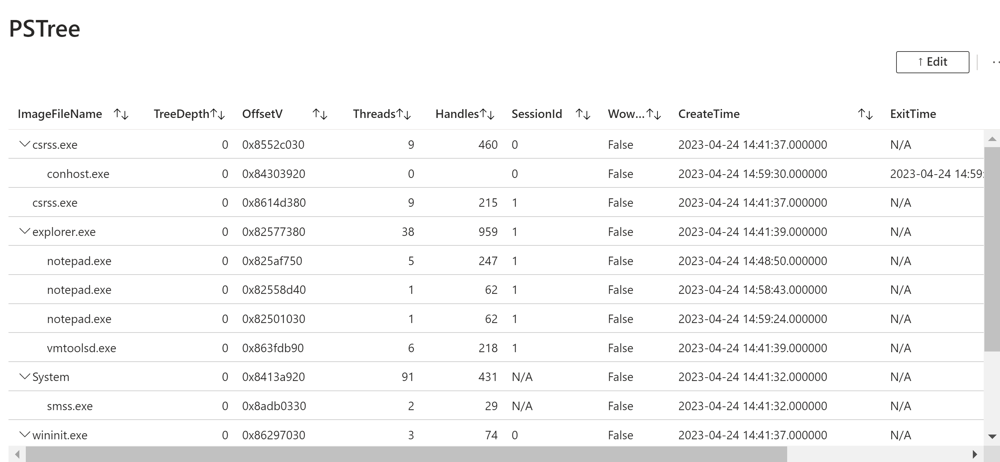
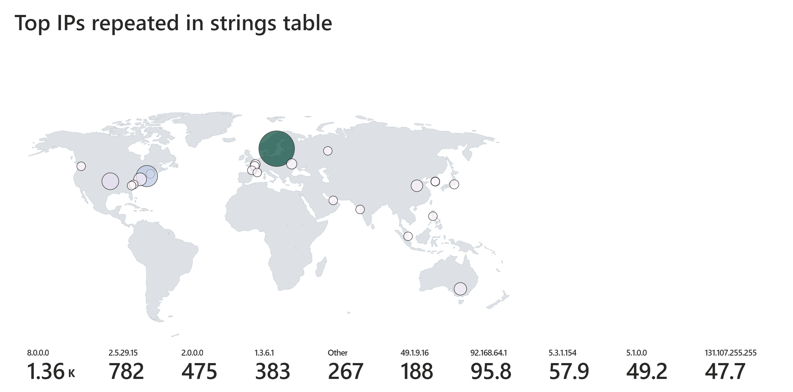
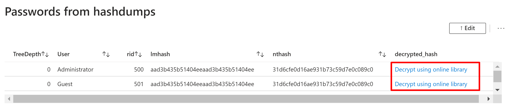
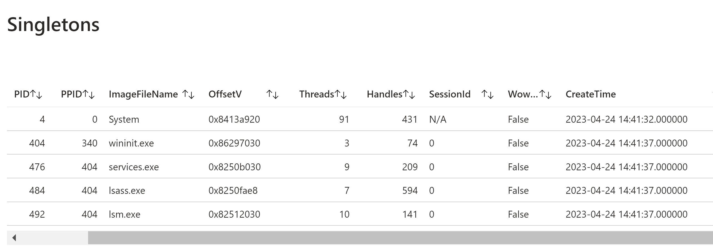

# AjourVolAutolity

## Goal of the project
The goal of this project is
- leveraging power of the cloud,
- automate the volatility commands,
- speed up the process from acquisition-end to analysis-start,
- utilizing the speed of KQL to find answers quickly on large data sets,
- spend time doing more important stuff than running a bunch of commands on repeat!

You can upload as many memory images as you need. Each image is analysed with Volatility 3 and its
results go into their own Azure Data Explorer (ADX) database.

> [!NOTE]
> This is a work in progress with a lot of additions and improvements already planned. If you want to contribute - please feel free to do so. Suggestions are also very welcome. Windows has the most coverage (and the workbook); Linux and macOS are supported by the pipeline but need kernel symbols.

### Workflow
1. The analyst deploys the stack with OpenTofu.
2. The analyst sends the upload instructions to whoever acquires the image(s).
3. That person uploads.
4. A worker VM picks up each upload, runs ~80 Volatility plugins and streams every result table into
   ADX while the rest are still running.
5. The analyst starts querying as soon as the first tables land. From upload to querying it is
   hands-off.



## Parent Child relations
An important part of knowing how to analyse memory dumps is to be aware of known goods. I've created this overview which i tend to analyse and update from time to time.


# Process of setting it up and "How to"

## Requirements

### Tools
- **[OpenTofu](https://opentofu.org/docs/intro/install/) 1.10 or newer:** `winget install OpenTofu.Tofu`.
- **[Azure CLI](https://learn.microsoft.com/en-us/cli/azure/install-azure-cli).**
- **An SSH key pair.** It's only used for troubleshooting on the worker VM.

```powershell
az login
az account set --subscription "<subscription id or name>"
```

### Roles in Azure
- **Owner on the subscription, or Contributor + User Access Administrator.** The deployment creates
  role assignments for the worker's managed identity. That identity's roles are scoped to the
  storage account and the ADX cluster, not to the subscription.
- **ADX `AllDatabasesAdmin` is granted to you automatically.** You need it to query the databases
  and use the workbook.

## Steps to deploy

**1. One-time: create the remote state storage.** It is a separate module, so destroying a lab never
deletes its own state.
```powershell
cd cfg/bootstrap
tofu init
tofu apply -var subscriptionid=<id> -var subscriptionname=<name>
tofu output backend_config
```

**2. Configure.** Nothing environment-specific is committed:
```powershell
cd ..
copy variables.auto.tfvars.example variables.auto.tfvars   # git-ignored; fill in subscription + state values
```
Other knobs are in [variables.tf](cfg/variables.tf): VM size, ADX SKU, YARA rules, slow plugins,
work directory, and so on.

**3. Deploy.** The ADX cluster takes about 15 minutes; the VM installs itself through cloud-init.
```powershell
tofu init
tofu plan -out tfplan
tofu apply tfplan
tofu output -raw setup_and_instructions   # upload commands + SAS link to hand out
```

**4. Upload** memory images named `<os>_<anything>.<ext>`, e.g. `win_acme-dc01_20261010.raw`, where
`<os>` is `win`, `linux` or `mac`. `.gz`/`.zip` compressed uploads are accepted.
[docs/ACQUISITION.md](docs/ACQUISITION.md) covers acquiring memory on-prem, from hypervisors and
from Azure VMs, plus the upload options:
- `azcopy` with the upload-only SAS link,
- `avml --sas-url` straight from a Linux host,
- `az storage blob upload --auth-mode login` for tenant users.

To analyse an image you already have, drop it into `VolAutolity/sample/` before `tofu apply`; it is
uploaded like any other.

**5. Query.**
- Open the *Windows Triage Workbook* in the resource group, or query the cluster directly.
- Each image has its own database, named after the file.
- Start with `volautolity_runs` (what ran, what failed and why) and `volautolity_image` (name, size,
  SHA-256).

## What happens on the worker
The worker is a small Python service, [VolAutolity/volautolity](VolAutolity/volautolity), run by
systemd under a dedicated, sandboxed user:

- **Polling.** It polls the upload container through the Storage SDK. This catches uploads from
  anywhere (the old blobfuse + inotify approach never saw remote uploads). Progress is recorded in
  blob metadata (`volautolity_status`).
- **One image at a time.** It downloads and, if needed, decompresses the image, then hashes it
  (SHA-256) while analysing. If the uploader attached a `sha256` value, it verifies the image against it.
- **Kernel resolved once.** It resolves the kernel once (`windows.info --save-config`), and every
  other plugin reuses that config instead of re-scanning the image.
- **Bounded parallelism.** It runs about 80 plugins with a bounded worker pool: about one process per
  core, capped by RAM, so images no longer thrash the VM. High-value plugins run first; whole-image
  passes such as strings, timeliner, dumpfiles and YARA run last.
- **Streaming ingestion.** Each CSV is ingested as soon as it is ready:
  - **Schema from the CSV header.** No hand-written schemas that drift when Volatility changes.
  - **Inferred types.**
  - **An explicit column mapping**, so a reordered column can't land in the wrong place.
  - **Ingestion batching set to 20 seconds**, so tables appear quickly.
- **Results upload.** CSVs, logs, dumped registry hives and files are uploaded to the `results`
  container.

The plugin list and table names are in [docs/PLUGINS.md](docs/PLUGINS.md).

### Running it locally
You can test plugins against an image on your own machine without Azure:
```powershell
cd VolAutolity
python -m venv .venv; .venv\Scripts\pip install -r requirements.txt
$env:VOL_COMMAND = ".venv\Scripts\vol.exe"; $env:WORK_DIR = "$PWD\work"
.venv\Scripts\python -m volautolity process ..\win_case.raw --no-ingest --only pslist,netscan
.venv\Scripts\python -m volautolity plugins --os windows
```
Tests: `python -m unittest discover -s tests`. Volatility and the Azure SDKs are optional for most
tests; installing them enables the catalog checks.

## Security model
- **No secrets in the repository.** Environment values live in a git-ignored tfvars, and CI uses
  repository variables plus OIDC.
- **No secrets on the VM.** It authenticates with a user-assigned managed identity. That identity has:
  - Storage Blob Data Contributor on the one storage account.
  - Contributor on the one ADX cluster, to create databases.
  - ADX AllDatabasesAdmin.
- **Private storage.** Containers are private, public blob access is disabled, and TLS 1.2 is the
  minimum. Blob soft delete keeps overwritten or deleted images for 7 days.
- **Upload-only SAS for external uploaders.** It is container-scoped and HTTPS-only. It cannot read,
  list or delete. Its validity is configurable (7 days by default), and rotating the account key
  revokes it.
- **Locked-down VM:**
  - SSH only, from the deploying IP, keys only.
  - Trusted Launch (secure boot + vTPM).
  - The service runs as an unprivileged user with systemd sandboxing (`ProtectSystem=strict`, no
    capabilities, ...).
- **Pinned supply chain.** Python dependencies are pinned. Third-party downloads (YARA rules,
  community plugins) are pinned to a commit and SHA-256-verified before use.
- **Untrusted input is handled defensively:**
  - Blob names never become paths.
  - Archive member names are ignored.
  - ADX identifiers are sanitised and bracketed.
  - No shell is involved in running tools.
- **Chain of custody.** Every image's SHA-256 is recorded in ADX (`volautolity_image`) and in the
  blob's metadata.

## CI/CD
- **[ci.yml](.github/workflows/ci.yml)** runs on every push/PR: `tofu fmt/validate`, Python tests
  and shellcheck. It needs no Azure access.
- **[plan.yml](.github/workflows/plan.yml) / [apply.yml](.github/workflows/apply.yml)** are manual,
  and log in to Azure with OIDC, so no client secret is stored. They need:
  - An app registration with a federated credential for this repository (environment `production`
    for apply), and the roles from *Roles in Azure*.
  - Repository **variables**:
    - Identity: `AZURE_CLIENT_ID`, `AZURE_TENANT_ID`.
    - Subscription: `AZURE_SUBSCRIPTION_ID`, `AZURE_SUBSCRIPTION_NAME`.
    - State backend: `TF_STATE_RESOURCE_GROUP`, `TF_STATE_STORAGE_ACCOUNT`.
    - Worker access: `SSH_PUBLIC_KEY`, `OPERATOR_IP`.

## Troubleshooting
SSH in with the command from `tofu output -raw setup_and_instructions`, then:
```bash
sudo tail -f /var/log/cloud-init-output.log      # first-boot setup (packages, venv, ClamAV, service)
journalctl -u volautolity -f                     # the worker
ls /mnt/volautolity/output/<database>/logs       # per-plugin stderr/log, saved Volatility config
sudo bash /opt/volautolity/app/deploy/setup.sh   # re-run setup (idempotent)
```

Notes:
- **Kusto ingestion failures** show up in `.show ingestion failures` on the cluster.
- **Code changes replace the VM.** The app is shipped inside cloud-init `custom_data`, which can't
  be changed in place, so changing the Python code re-creates the worker VM on the next apply.
- **Migrating an existing Terraform deployment.** Run `tofu init` (OpenTofu reads the existing state;
  provider addresses are translated automatically), then `tofu plan`. The plan will:
  - Remove the old service principal, Ansible provisioner and over-broad role assignments.
  - Forget, without destroying, the state storage resources (now in `cfg/bootstrap`).
  - Replace the VM.

## Time notes (give or take)
- The ADX cluster often takes around 15 minutes to set up.
- The VM is ready a few minutes after creation. Watch `cloud-init-output.log`.
- On a `Standard_F8s_v2`, the core tables of a typical Windows image land within minutes of the
  upload finishing.
- The slow plugins (strings, timeliner, dumpfiles + ClamAV, YARA) can take much longer on big images.

## Screenshots










And much more on the way...

# Workbook additions/considerations
- Windows 7 = Taskhost.exe, Windows 8 = Taskhostex.exe, Windows 10 = Taskhostw.exe
- #Get enabled privileges of some processes
    python3 vol.py -f file.dmp windows.privileges.Privs [--pid <pid>]
    #Get all processes with interesting privileges
    python3 vol.py -f file.dmp windows.privileges.Privs | grep "SeImpersonatePrivilege\|SeAssignPrimaryPrivilege\|SeTcbPrivilege\|SeBackupPrivilege\|SeRestorePrivilege\|SeCreateTokenPrivilege\|SeLoadDriverPrivilege\|SeTakeOwnershipPrivilege\|SeDebugPrivilege
    pass
- Similar sounding process names
- Decrypt base 64 strings CompromisedSystemMem.vmem | grep -E '[A-Za-z0-9+/]{4}*([A-Za-z0-9+/]{4}|[A-Za-z0-9+/]{3}=|[A-Za-z0-9+/]{2}==)' | grep -vE '^.{1,40}$' |  grep -E '^[A-Za-z0-9+/]+={0,2}$' | base64 -d | less
- Strings of interest list
- Recently changed Registries
- OTX and virustotal lookup
- New tables to surface: consoles/cmdscan (command history), amcache, scheduled_tasks, svcdiff, pebmasquerade, direct/indirect_system_calls, etwpatch (see [docs/PLUGINS.md](docs/PLUGINS.md))

# Memory dumps for testing
https://github.com/stuxnet999/MemLabs/tree/master/Lab%200
https://www.osforensics.com/tools/volatility-workbench.html
https://archive.org/details/Africa-DFIRCTF-2021-WK02

## Notes on a few decisions
- **PSTree** is not run; the tree is produced in the workbook instead.
- **OpenTofu** is used instead of Terraform (open source, MPL). Two OpenTofu-only features are used:
  variables in the backend block, and `removed` blocks. State encryption is available if wanted (see
  [SUGGESTIONS.md](SUGGESTIONS.md)).
- **Table naming convention:**
  - Remove spaces
  - Remove Parentheses

<details><summary>Resources: </summary>
<ul>
<li>https://github.com/hashicorp/terraform-provider-azurerm/issues/15649</li>
<li>https://learn.microsoft.com/en-us/azure/data-explorer/create-cluster-database?tabs=azcli </li>
<li>https://learn.microsoft.com/en-us/cli/azure/authenticate-azure-cli-managed-identity</li>
<li>https://azure-training.com/azure-data-science/creating-the-adx-environment/creating-adx-environment-using-cli/</li>
<li>https://learn.microsoft.com/en-us/cli/azure/kusto/database?view=azure-cli-latest#az-kusto-database-update(kusto)</li>
<li>https://learn.microsoft.com/en-us/azure/data-explorer/python-ingest-data</li>
<li>https://github.com/Azure/azure-kusto-python/blob/master/azure-kusto-ingest/tests/sample.py</li>
<li>https://search.opentofu.org/provider/hashicorp/azurerm/latest</li>
<li>https://opentofu.org/docs/intro/migration/</li>
<li>https://pypi.org/project/azure-kusto-ingest/</li>
<li>https://learn.microsoft.com/en-us/azure/data-explorer/kusto/tools/kusto-cli</li>
<li>https://thelearningjourneyebooks.com/</li>
<li>https://github.com/vavarachen/volatility_automation</li>
<li>https://github.com/volatilityfoundation/volatility3/blob/develop/vol.py</li>
<li>https://downloads.volatilityfoundation.org/releases/2.4/CheatSheet_v2.4.pdf</li>
<li>https://learn.microsoft.com/en-us/azure/data-explorer/kusto/management/data-ingestion/ingest-from-storage</li>
<li>https://learn.microsoft.com/en-us/kusto/management/batching-policy?view=azure-data-explorer</li>
<li>https://github.com/Azure/azure-kusto-python</li>
<li>https://www.techbrothersit.com/2022/02/how-to-create-single-or-multiple-tables.html</li>
<li>https://www.huuhka.net/devops-for-azure-workbooks/</li>
<li>https://learn.microsoft.com/en-us/azure/data-explorer/kusto/query/geospatial-visualizations</li>
<li>https://learn.microsoft.com/en-us/azure/azure-monitor/visualize/workbooks-tree-visualizations</li>
<li>https://github.com/Dead-Simple-Scripts/AutoVol-SDF-Memory-Forensics-2/blob/master/autovol_mem2_example.sh</li>
<li>https://github.com/Yara-Rules/rules</li>
<li>https://github.com/k1nd0ne/VolWeb</li>
<li>https://github.com/carlospolop/autoVolatility</li>
<li>https://learn.microsoft.com/en-us/azure/data-explorer/kusto/query/visualization-timepivot?pivots=azuredataexplorer</li>
<li>https://learn.microsoft.com/en-us/azure/data-explorer/kusto/query/visualization-linechart?pivots=azuredataexplorer</li>
<li>https://www.cloudsma.com/2021/01/azure-workbooks-icons-thresholds-heatmaps/</li>
<li>https://learn.microsoft.com/en-us/azure/data-explorer/kusto/query/visualization-treemap?pivots=azuredataexplorer</li>
<li>https://learn.microsoft.com/en-us/azure/azure-monitor/visualize/workbooks-grid-visualizations</li>
<li>https://reversea.me/index.php/writing-a-volatility-3-plugin/</li>
<li>https://hostingjournalist.com/how-to-build-tabs-and-alerts-in-azure-workbooks-azure-portal-series/</li>
<li>https://github.com/microsoft/avml</li>
<li>https://github.com/Velocidex/WinPmem</li>
</ul>
</details>
