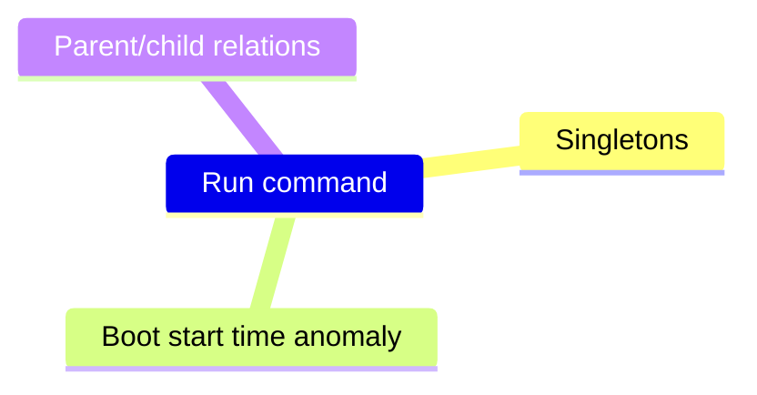

# Volatility plugins and ADX tables

Generated from [`VolAutolity/volautolity/catalog.py`](../VolAutolity/volautolity/catalog.py)
(`python -m volautolity plugins --os windows|linux|mac`). Targets **Volatility 3 2.28.x**.
`tests/test_catalog.py` fails if a plugin name stops existing, becomes a deprecated alias, or gains
a required option, so a Volatility upgrade can't silently drop tables.

- **One database per image.** Every image gets its own ADX database. Every plugin writes one table,
  except `registry_hivelist`, which also creates one `printkey_<HIVE>` table per hive.
- **Columns come from the plugin's own declaration.** They are the plugin's TreeGrid columns in
  Volatility's source, recorded in
  [`VolAutolity/volautolity/schemas.json`](../VolAutolity/volautolity/schemas.json) by
  `tools/gen_schemas.py`.
  - Names have spaces and parentheses removed (`Offset(V)` becomes `OffsetV`, `File output` becomes
    `Fileoutput`).
  - Types are the declared ones: `long`, `bool`, `datetime`, `real` or `string`. A value that doesn't
    fit the declared type becomes null rather than failing ingestion.
  - Columns a newer Volatility adds are typed by inference.
- **Every table is created up front, once the OS is known.** A plugin that fails or finds nothing
  leaves an empty, typed table, so workbook queries don't break.
- **Every table has a `VolRow` column:** the row's position in Volatility's output. The order carries
  meaning that ADX doesn't preserve: the first `dlllist` module is the executable, the first `getsids`
  SID is the token user, and console history is ordered.
- **Priority sets the order, not whether a plugin runs.** `core` plugins run first so the workbook
  fills early; `slow` ones (whole-image passes) run last at lower CPU priority.
- **Every image also gets these tables:**
  - `volautolity_runs`: per plugin, its status, row count and error.
  - `volautolity_image`: name, size, SHA-256, timings.
  - Function `taskhost_triage()` (Windows).

New since the previous bash runner are, for example, consoles/cmdscan (command history), amcache,
scheduled tasks, svclist/svcdiff, the system-call/ETW-patch/PEB-masquerade malware checks, GUI
objects, MFT ADS/resident data, and thread scanning. Linux and Mac coverage is new altogether.
Plugin names follow the 2.26/2.27 moves to `windows.registry.*` and `windows.malware.*`. The old
names are deprecated aliases past their removal date.

## Not run on purpose

| Plugin | Why |
|---|---|
| `windows.pe_symbols`, `windows.pedump`, `linux.module_extract`, `linux.pagecache.InodePages` | Require a module/base address/inode: targeted follow-ups, not triage. |
| `regexscan`, `windows.vadregexscan`, `linux.vmaregexscan` | Require `--pattern`. A configurable pattern list is a possible extension. |
| `windows.memmap` | Without `--pid` the output has no PID column, so it's unusable as a table. |
| `windows.crashinfo` | Works only on crash dumps. |
| `windows.registry.hivescan` | Removed earlier: `hivelist` covers it. |
| `windows.pstree` | The tree is built in the workbook from `pslist`. |
| `layerwriter`, `configwriter`, `frameworkinfo`, `isfinfo` | Tooling, not analysis. `banners` runs only as a diagnostic when no OS profile matches. |
| `cobaltstrike` (Immersive Labs, community) | Requires `pslist` 2.x; Volatility 2.28 ships 3.x, so it no longer loads. |

## Catalog

### Windows (84 plugins)

| Table | Plugin | Priority | Notes |
|---|---|---|---|
| `info` | `windows.info.Info` | bootstrap | resolves the kernel once; the saved config is reused by every later plugin |
| `cachedump` | `windows.registry.cachedump.Cachedump` | core |  |
| `cmdline` | `windows.cmdline.CmdLine` | core |  |
| `cmdscan` | `windows.cmdscan.CmdScan` | core | new; x64 Win10+ |
| `consoles` | `windows.consoles.Consoles` | core | new; x64 Win10+ |
| `dlllist` | `windows.dlllist.DllList` | core |  |
| `getsids` | `windows.getsids.GetSIDs` | core |  |
| `handles` | `windows.handles.Handles` | core |  |
| `hashdump` | `windows.registry.hashdump.Hashdump` | core |  |
| `lsadump` | `windows.registry.lsadump.Lsadump` | core |  |
| `malfind` | `windows.malware.malfind.Malfind` | core |  |
| `netscan` | `windows.netscan.NetScan` | core |  |
| `netstat` | `windows.netstat.NetStat` | core |  |
| `privileges` | `windows.privileges.Privs` | core |  |
| `pslist` | `windows.pslist.PsList` | core |  |
| `psscan` | `windows.psscan.PsScan` | core |  |
| `registry_hivelist` | `windows.registry.hivelist.HiveList` | core | dumps hives; + one `printkey_<HIVE>` table per hive |
| `sessions` | `windows.sessions.Sessions` | core |  |
| `svcscan` | `windows.svcscan.SvcScan` | core |  |
| `Statistics` | `windows.statistics.Statistics` | default |  |
| `amcache` | `windows.registry.amcache.Amcache` | default | new |
| `bigpools` | `windows.bigpools.BigPools` | default |  |
| `callbacks` | `windows.callbacks.Callbacks` | default |  |
| `debugregisters` | `windows.debugregisters.DebugRegisters` | default | new |
| `deskscan` | `windows.deskscan.DeskScan` | default | new; GUI, x64 |
| `desktops` | `windows.desktops.Desktops` | default | new; GUI, x64 |
| `devicetree` | `windows.devicetree.DeviceTree` | default |  |
| `direct_system_calls` | `windows.malware.direct_system_calls.DirectSystemCalls` | default | new |
| `driverirp` | `windows.driverirp.DriverIrp` | default |  |
| `drivermodule` | `windows.malware.drivermodule.DriverModule` | default |  |
| `driverscan` | `windows.driverscan.DriverScan` | default |  |
| `envars` | `windows.envars.Envars` | default |  |
| `etwpatch` | `windows.etwpatch.EtwPatch` | default | new |
| `filescan` | `windows.filescan.FileScan` | default |  |
| `getcellroutine` | `windows.registry.getcellroutine.GetCellRoutine` | default |  |
| `getservicesids` | `windows.getservicesids.GetServiceSIDs` | default |  |
| `gui_windows` | `windows.windows.Windows` | default | new; GUI, x64 |
| `hollowprocesses` | `windows.malware.hollowprocesses.HollowProcesses` | default |  |
| `iat` | `windows.iat.IAT` | default |  |
| `indirect_system_calls` | `windows.malware.indirect_system_calls.IndirectSystemCalls` | default | new |
| `joblinks` | `windows.joblinks.JobLinks` | default |  |
| `kpcrs` | `windows.kpcrs.KPCRs` | default |  |
| `ldrmodules` | `windows.malware.ldrmodules.LdrModules` | default |  |
| `mbrscan` | `windows.mbrscan.MBRScan` | default |  |
| `mftscan` | `windows.mftscan.MFTScan` | default |  |
| `mftscan_ads` | `windows.mftscan.ADS` | default | new |
| `modscan` | `windows.modscan.ModScan` | default |  |
| `modules` | `windows.modules.Modules` | default |  |
| `mutantscan` | `windows.mutantscan.MutantScan` | default |  |
| `orphan_kernel_threads` | `windows.orphan_kernel_threads.Threads` | default | new |
| `pebmasquerade` | `windows.malware.pebmasquerade.PebMasquerade` | default | new |
| `poolscanner` | `windows.poolscanner.PoolScanner` | default |  |
| `processghosting` | `windows.malware.processghosting.ProcessGhosting` | default |  |
| `psxview` | `windows.malware.psxview.PsXView` | default |  |
| `registry` | `windows.registry.certificates.Certificates` | default | table name kept for compatibility |
| `registry_printkey` | `windows.registry.printkey.PrintKey` | default |  |
| `registry_userassist` | `windows.registry.userassist.UserAssist` | default |  |
| `scheduled_tasks` | `windows.registry.scheduled_tasks.ScheduledTasks` | default | new; x64 only in 2.28.2 |
| `shimcachemem` | `windows.shimcachemem.ShimcacheMem` | default |  |
| `skeleton_key_check` | `windows.malware.skeleton_key_check.Skeleton_Key_Check` | default |  |
| `ssdt` | `windows.ssdt.SSDT` | default |  |
| `suspended_threads` | `windows.suspended_threads.SuspendedThreads` | default | new |
| `suspicious_threads` | `windows.malware.suspicious_threads.SuspiciousThreads` | default |  |
| `svcdiff` | `windows.malware.svcdiff.SvcDiff` | default | new; x64 Win10 15063+ |
| `svclist` | `windows.svclist.SvcList` | default | new; x64 Win10 15063+ |
| `symlinkscan` | `windows.symlinkscan.SymlinkScan` | default |  |
| `thrdscan` | `windows.thrdscan.ThrdScan` | default | new |
| `threads` | `windows.threads.Threads` | default |  |
| `timers` | `windows.timers.Timers` | default |  |
| `truecrypt` | `windows.truecrypt.Passphrase` | default |  |
| `unhooked_system_calls` | `windows.malware.unhooked_system_calls.UnhookedSystemCalls` | default | new |
| `unloadedmodules` | `windows.unloadedmodules.UnloadedModules` | default |  |
| `vadinfo` | `windows.vadinfo.VadInfo` | default |  |
| `vadwalk` | `windows.vadwalk.VadWalk` | default |  |
| `verinfo` | `windows.verinfo.VerInfo` | default |  |
| `virtmap` | `windows.virtmap.VirtMap` | default |  |
| `windowstations` | `windows.windowstations.WindowStations` | default | new; GUI, x64 |
| `dumpfiles` | `windows.dumpfiles.DumpFiles` | slow | dumps files; + `clamscan` table |
| `mftscan_residentdata` | `windows.mftscan.ResidentData` | slow | new |
| `strings` | `windows.strings.Strings` | slow | GNU strings pre-pass (ASCII + UTF-16LE) |
| `timeliner` | `timeliner.Timeliner` | slow |  |
| `vadyarascan` | `windows.vadyarascan.VadYaraScan` | slow | only with YARA rules |
| `vmscan` | `vmscan.Vmscan` | slow | only finds something on hypervisor hosts |
| `yarascan` | `yarascan.YaraScan` | slow | only with YARA rules |

### Linux (48 plugins, all new; need kernel symbols, see [ACQUISITION.md](ACQUISITION.md#linux))

| Table | Plugin | Priority | Notes |
|---|---|---|---|
| `boottime` | `linux.boottime.Boottime` | bootstrap |  |
| `bash` | `linux.bash.Bash` | core |  |
| `malfind` | `linux.malware.malfind.Malfind` | core |  |
| `psaux` | `linux.psaux.PsAux` | core |  |
| `pslist` | `linux.pslist.PsList` | core |  |
| `psscan` | `linux.psscan.PsScan` | core |  |
| `pstree` | `linux.pstree.PsTree` | core |  |
| `sockstat` | `linux.sockstat.Sockstat` | core |  |
| `capabilities` | `linux.capabilities.Capabilities` | default |  |
| `check_afinfo` | `linux.malware.check_afinfo.Check_afinfo` | default |  |
| `check_creds` | `linux.malware.check_creds.Check_creds` | default |  |
| `check_idt` | `linux.malware.check_idt.Check_idt` | default |  |
| `check_modules` | `linux.malware.check_modules.Check_modules` | default |  |
| `check_syscall` | `linux.malware.check_syscall.Check_syscall` | default |  |
| `ebpf` | `linux.ebpf.EBPF` | default |  |
| `elfs` | `linux.elfs.Elfs` | default |  |
| `envars` | `linux.envars.Envars` | default |  |
| `fbdev` | `linux.graphics.fbdev.Fbdev` | default |  |
| `ftrace` | `linux.tracing.ftrace.CheckFtrace` | default |  |
| `hidden_modules` | `linux.malware.hidden_modules.Hidden_modules` | default |  |
| `iomem` | `linux.iomem.IOMem` | default |  |
| `ip_addr` | `linux.ip.Addr` | default |  |
| `ip_link` | `linux.ip.Link` | default |  |
| `kallsyms` | `linux.kallsyms.Kallsyms` | default |  |
| `keyboard_notifiers` | `linux.malware.keyboard_notifiers.Keyboard_notifiers` | default |  |
| `kmsg` | `linux.kmsg.Kmsg` | default |  |
| `kthreads` | `linux.kthreads.Kthreads` | default | kernel 5.8+ |
| `library_list` | `linux.library_list.LibraryList` | default |  |
| `lsmod` | `linux.lsmod.Lsmod` | default |  |
| `lsof` | `linux.lsof.Lsof` | default |  |
| `modxview` | `linux.malware.modxview.Modxview` | default |  |
| `mountinfo` | `linux.mountinfo.MountInfo` | default |  |
| `netfilter` | `linux.malware.netfilter.Netfilter` | default |  |
| `perf_events` | `linux.tracing.perf_events.PerfEvents` | default |  |
| `pidhashtable` | `linux.pidhashtable.PIDHashTable` | default |  |
| `proc_maps` | `linux.proc.Maps` | default |  |
| `process_spoofing` | `linux.malware.process_spoofing.ProcessSpoofing` | default |  |
| `pscallstack` | `linux.pscallstack.PsCallStack` | default |  |
| `ptrace` | `linux.ptrace.Ptrace` | default |  |
| `sockscan` | `linux.sockscan.Sockscan` | default |  |
| `tracepoints` | `linux.tracing.tracepoints.CheckTracepoints` | default |  |
| `tty_check` | `linux.malware.tty_check.Tty_Check` | default |  |
| `vmcoreinfo` | `linux.vmcoreinfo.VMCoreInfo` | default |  |
| `pagecache_files` | `linux.pagecache.Files` | slow |  |
| `pagecache_recoverfs` | `linux.pagecache.RecoverFs` | slow | writes a tarball of the page cache (results container) |
| `timeliner` | `timeliner.Timeliner` | slow |  |
| `vmayarascan` | `linux.vmayarascan.VmaYaraScan` | slow | only with YARA rules |
| `yarascan` | `yarascan.YaraScan` | slow | only with YARA rules |

### Mac (25 plugins, all new; upstream no longer actively maintains mac support)

| Table | Plugin | Priority | Notes |
|---|---|---|---|
| `dmesg` | `mac.dmesg.Dmesg` | bootstrap |  |
| `bash` | `mac.bash.Bash` | core |  |
| `malfind` | `mac.malfind.Malfind` | core |  |
| `netstat` | `mac.netstat.Netstat` | core |  |
| `psaux` | `mac.psaux.Psaux` | core |  |
| `pslist` | `mac.pslist.PsList` | core |  |
| `pstree` | `mac.pstree.PsTree` | core |  |
| `check_syscall` | `mac.check_syscall.Check_syscall` | default |  |
| `check_sysctl` | `mac.check_sysctl.Check_sysctl` | default |  |
| `check_trap_table` | `mac.check_trap_table.Check_trap_table` | default |  |
| `ifconfig` | `mac.ifconfig.Ifconfig` | default |  |
| `kauth_listeners` | `mac.kauth_listeners.Kauth_listeners` | default |  |
| `kauth_scopes` | `mac.kauth_scopes.Kauth_scopes` | default |  |
| `kevents` | `mac.kevents.Kevents` | default |  |
| `list_files` | `mac.list_files.List_Files` | default |  |
| `lsmod` | `mac.lsmod.Lsmod` | default |  |
| `lsof` | `mac.lsof.Lsof` | default |  |
| `mount` | `mac.mount.Mount` | default |  |
| `proc_maps` | `mac.proc_maps.Maps` | default |  |
| `socket_filters` | `mac.socket_filters.Socket_filters` | default |  |
| `timers` | `mac.timers.Timers` | default |  |
| `trustedbsd` | `mac.trustedbsd.Trustedbsd` | default |  |
| `vfsevents` | `mac.vfsevents.VFSevents` | default |  |
| `timeliner` | `timeliner.Timeliner` | slow |  |
| `yarascan` | `yarascan.YaraScan` | slow | only with YARA rules |

## Notes on specific plugins

### windows.bigpools.BigPools
Analyses large memory pools. Windows uses memory pools to manage dynamic allocations for system
components and drivers: it pre-allocates a large block and hands out smaller chunks of it as needed,
which reduces fragmentation and allocation overhead.

- **Memory analysis:** find large pool allocations, memory leaks and unusual usage patterns.
- **Forensics:** spot suspicious pool usage by malware or unauthorised drivers.

### windows.pslist / windows.psscan
- **pslist** walks the active process list.
- **psscan** scans all of memory, including unallocated space, for process structures. It finds
  processes that have exited, and processes that malware has unlinked from the list.

The workbook compares the two (`pslist | join kind=leftanti psscan on PID`) and checks:

### Backslashes in paths
Volatility's CSV writer escapes backslashes (`C:\\Windows`). The worker decodes this, so paths in ADX
are normal Windows paths (`C:\Windows\System32`). Databases created by the earlier bash runner still
contain doubled backslashes.
